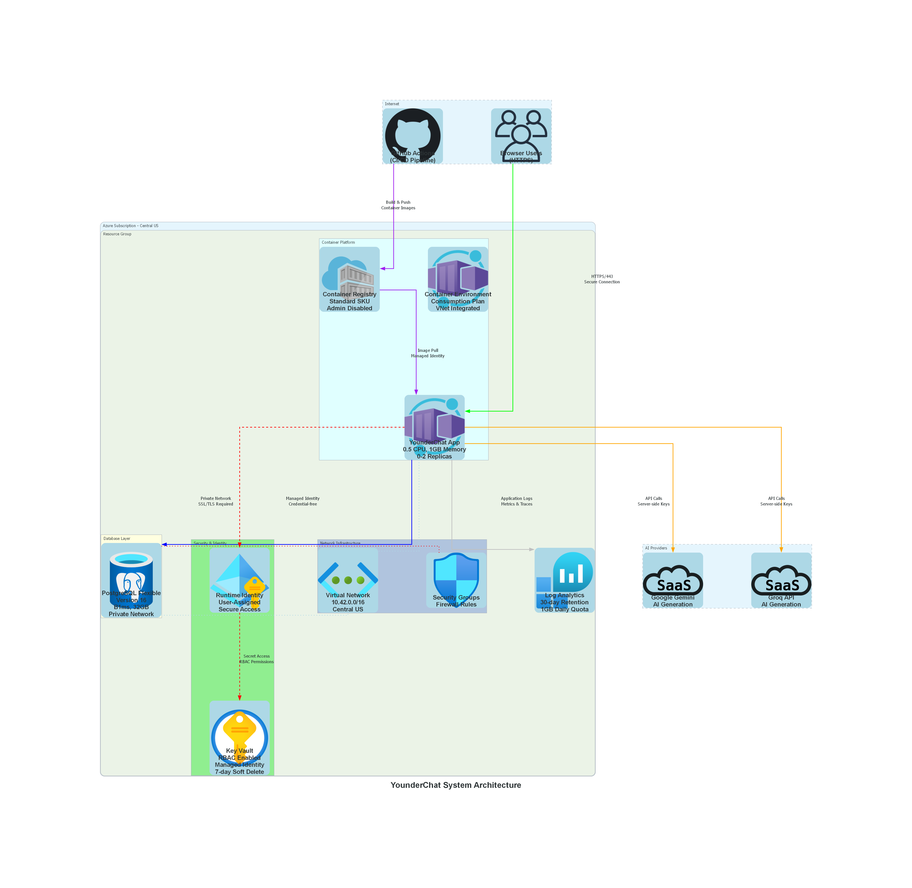

# YounderChat — System Architecture

Professional ChatGPT-style application built with React, TypeScript, FastAPI, and deployed on Microsoft Azure using Infrastructure as Code principles.

*Professional Azure architecture diagram with official Microsoft service icons*

## 🏗️ Architecture Overview

YounderChat uses a modern, cloud-native architecture deployed on Microsoft Azure:

- **Frontend**: React + TypeScript + Material UI
- **Backend**: FastAPI with SQLAlchemy + Alembic  
- **Database**: Azure PostgreSQL Flexible Server (private networking)
- **Hosting**: Azure Container Apps with auto-scaling
- **Security**: Key Vault + Managed Identity (credential-free)
- **CI/CD**: GitHub Actions with OIDC federation
- **Monitoring**: Azure Log Analytics

## 📊 Detailed Architecture Diagrams

- **[Azure Infrastructure](diagrams/azure-infrastructure.md)** - Complete Azure services with configurations
- **[Network Topology](diagrams/network-topology.md)** - VNet design, subnets, and security  
- **[Security Architecture](diagrams/security-architecture.md)** - Identity management and access controls
- **[CI/CD Pipeline](diagrams/cicd-pipeline.md)** - Automated deployment pipeline
- **[Data Model](diagrams/data-model.md)** - PostgreSQL schema and relationships
- **[User Workflow](diagrams/user-workflow.md)** - End-to-end user journey

## 🔄 Request Flow

### User Authentication
1. Browser submits credentials to FastAPI
2. API validates against PostgreSQL (via private network)
3. bcrypt password verification with session token generation  
4. HttpOnly secure cookies with CSRF protection

### Chat Processing
1. User message validated for session, ownership, and quotas
2. Message persisted to PostgreSQL with conversation threading
3. AI provider selection (Gemini/Groq) with server-side API keys
4. Streaming response with real-time UI updates
5. Usage tracking and quota management

### Infrastructure Deployment
1. GitHub Actions triggered on main branch push
2. OIDC token exchange for Azure authentication
3. Docker image build and push to Container Registry
4. Database migrations via VNet-integrated job
5. Container Apps deployment with health checks

## 🛡️ Security Features

- **Private Database**: No public IP, private subnet only
- **Network Security**: NSG rules, private DNS zones
- **Identity Management**: Managed Identity (no stored credentials)  
- **Secret Management**: Azure Key Vault with RBAC
- **Transport Security**: HTTPS/SSL everywhere
- **Application Security**: Session cookies, CSRF protection, input validation

## 📈 Scalability & Performance

- **Auto-scaling**: Container Apps scale 0-2 replicas on demand
- **Connection Pooling**: Efficient database connections
- **Caching**: Client-side caching with TanStack Query
- **CDN Ready**: Static assets served from container

## 🌐 Production Deployment

**Demo Environment**: https://aichat.sdigurukulam.in/

*Uses developer's personal domain for interview demonstration*

## 📚 Related Documentation

- **[Implementation Plan](implementation-plan.md)** - Project scope and acceptance criteria
- **[Implementation Status](implementation-status.md)** - Current features and limitations  
- **[User Workflow](user-workflow.md)** - Business process documentation
