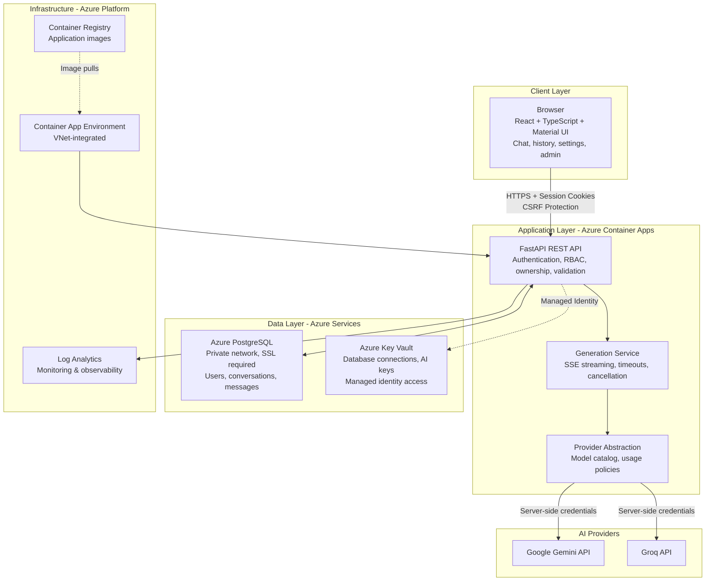

# YounderChat — System Architecture

## Architecture Navigation

This document provides a high-level overview of YounderChat's system architecture. For detailed technical diagrams and Azure-specific configurations, see:

- **[Azure Infrastructure Overview](diagrams/azure-infrastructure.md)** - Complete Azure services catalog with configurations
- **[Network Topology](diagrams/network-topology.md)** - VNet design, subnets, and security groups  
- **[Security Architecture](diagrams/security-architecture.md)** - Identity management, RBAC, and secret management
- **[CI/CD Pipeline](diagrams/cicd-pipeline.md)** - GitHub Actions workflows and deployment automation
- **[Data Model](diagrams/data-model.md)** - PostgreSQL schema and entity relationships
- **[User Workflow](diagrams/user-workflow.md)** - End-to-end user journey through Azure services

## System Overview

YounderChat is a ChatGPT-style application built with modern web technologies and deployed on Microsoft Azure using Infrastructure as Code principles. The system separates concerns between a React frontend, FastAPI backend, and cloud-native Azure services.

*For the complete Azure service topology with actual configurations, see [Azure Infrastructure](diagrams/azure-infrastructure.md)*

## Architecture Principles

### Cloud-Native Design
- **Containerized Application**: Multi-stage Docker build with distroless runtime
- **Infrastructure as Code**: Terraform-managed Azure resources
- **Microservices Pattern**: Separate concerns between frontend, API, and data layers
- **Managed Services**: Leverage Azure PostgreSQL, Key Vault, and Container Apps

### Security-First Approach
- **Zero Stored Secrets**: Managed identity and Key Vault integration
- **Network Isolation**: Private database subnet with Network Security Groups
- **Least Privilege Access**: RBAC-based permissions throughout the stack
- **Transport Security**: HTTPS everywhere with SSL/TLS for database connections

### Scalability & Performance
- **Auto-scaling**: Container Apps scale 0-2 replicas based on demand
- **Connection Pooling**: Efficient database connection management
- **Caching Strategy**: TanStack Query for client-side caching
- **CDN Ready**: Static assets served efficiently from container

### Operational Excellence
- **Observability**: Comprehensive logging to Azure Log Analytics
- **Health Monitoring**: Readiness and liveness probes
- **Automated Deployment**: GitHub Actions with OIDC federation
- **Disaster Recovery**: Point-in-time PostgreSQL backups

## Azure Infrastructure Components

### Core Platform Services
- **[Azure Container Apps](diagrams/azure-infrastructure.md#container-platform-services)**: Serverless container hosting with VNet integration
- **[Azure Container Registry](diagrams/azure-infrastructure.md#container-platform-services)**: Private container image repository
- **[Azure PostgreSQL Flexible Server](diagrams/azure-infrastructure.md#database-services)**: Managed database with private networking
- **[Azure Key Vault](diagrams/azure-infrastructure.md#security-services)**: Centralized secrets management with RBAC

### Network Infrastructure
- **[Virtual Network](diagrams/network-topology.md#virtual-network-configuration)**: Isolated network (10.42.0.0/16) with subnet segmentation
- **[Private DNS Zone](diagrams/network-topology.md#private-dns-configuration)**: Internal hostname resolution for PostgreSQL
- **[Network Security Groups](diagrams/network-topology.md#network-security-groups)**: Firewall rules protecting database subnet

### Security & Identity
- **[Managed Identities](diagrams/security-architecture.md#identity-and-access-management)**: Credential-free service authentication
- **[RBAC Assignments](diagrams/security-architecture.md#role-based-access-control-rbac)**: Least-privilege access controls
- **[GitHub OIDC Federation](diagrams/cicd-pipeline.md#oidc-federation-configuration)**: Secure CI/CD authentication

*For complete service configurations and pricing details, see [Azure Infrastructure Overview](diagrams/azure-infrastructure.md)*

## Request Processing Flow

### User Authentication
1. Browser submits credentials to FastAPI
2. API validates against PostgreSQL user records (via private network)
3. bcrypt password verification with session token generation
4. HttpOnly secure cookies with CSRF protection
5. Session stored in database with expiration tracking

*Detailed authentication flows in [Security Architecture](diagrams/security-architecture.md)*

### Chat Message Processing  
1. User message validated for session, ownership, and quota limits
2. Message persisted to PostgreSQL with conversation threading
3. AI provider selection based on model availability and plan policies
4. Server-side API keys retrieved from Key Vault via managed identity
5. Streaming response with real-time UI updates via Server-Sent Events
6. Usage tracking and quota management throughout the process

*Complete user journey documented in [User Workflow](diagrams/user-workflow.md)*

### Infrastructure Deployment
1. GitHub Actions triggered on main branch push
2. OIDC token exchange for Azure authentication
3. Multi-stage Docker image build and push to Container Registry
4. Database migrations executed via VNet-integrated job
5. Container Apps deployment with health checks and traffic shifting
6. Smoke tests validate deployment before completion

*Comprehensive CI/CD pipeline in [CI/CD Architecture](diagrams/cicd-pipeline.md)*

## Production Deployment Notes

### Demo Environment
The demonstration deployment is available at https://aichat.sdigurukulam.in/. This hostname uses the developer's personal domain registered through GoDaddy, configured specifically for interview demonstration purposes. It is not a Blue Yonder-owned domain.

### Deployment Verification
A successful CI run validates code quality and executes comprehensive tests but does not guarantee:
- Live AI provider availability or response quality  
- Current production deployment status
- Real-time system health or performance

*Always verify deployment status independently using the health endpoints and monitoring dashboards detailed in [Azure Infrastructure](diagrams/azure-infrastructure.md)*

## Related Technical Documentation

### Architecture Deep Dives
- **[Azure Infrastructure Overview](diagrams/azure-infrastructure.md)** - Complete Azure services with configurations and cost analysis
- **[Network Topology](diagrams/network-topology.md)** - VNet design, subnets, security groups, and traffic flows
- **[Security Architecture](diagrams/security-architecture.md)** - Identity management, RBAC, secrets, and compliance
- **[Data Model](diagrams/data-model.md)** - PostgreSQL schema, relationships, and performance patterns

### Process Documentation  
- **[CI/CD Pipeline](diagrams/cicd-pipeline.md)** - GitHub Actions, OIDC federation, and deployment automation
- **[User Workflow](diagrams/user-workflow.md)** - End-to-end user journey through Azure services
- **[End-to-end User Workflow](user-workflow.md)** - Business process documentation

### Planning and Implementation
- **[Implementation Plan](implementation-plan.md)** - Authoritative scope and acceptance criteria
- **[Implementation Status](implementation-status.md)** - Current feature boundaries and completion status
- **[Interview Preparation Q&A](prep/README.md)** - Technical interview questions and answers
