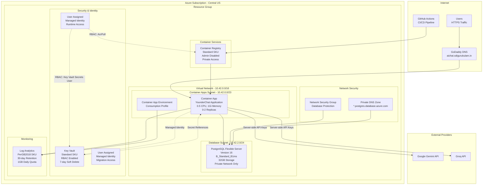

# Azure Infrastructure Architecture

This document provides a comprehensive overview of all Azure services used in the YounderChat application deployment, including their configurations, relationships, and data flows.

## Infrastructure Overview

YounderChat is deployed on Azure using a modern container-based architecture with private networking, managed identity-based security, and Infrastructure as Code (Terraform) deployment practices.

## Service Configuration Details

### Networking Services

| Service | Configuration | Details |
|---------|---------------|---------|
| **Virtual Network** | `{name}-vnet` | Address Space: `10.42.0.0/16`, Region: Central US |
| **Container Apps Subnet** | `container-apps` | CIDR: `10.42.0.0/23`, Delegated to `Microsoft.App/environments` |
| **Database Subnet** | `postgresql` | CIDR: `10.42.2.0/24`, Delegated to `Microsoft.DBforPostgreSQL/flexibleServers` |
| **Network Security Group** | `{name}-db-nsg` | Protects database subnet with specific inbound rules |
| **Private DNS Zone** | `{name}.postgres.database.azure.com` | Resolves PostgreSQL private endpoints |

### Container Platform Services

| Service | Configuration | SKU/Settings |
|---------|---------------|--------------|
| **Container Registry** | `bychat{6-char-suffix}` | Standard SKU, Admin disabled, Anonymous pull disabled |
| **Container App Environment** | `{name}-environment` | Consumption workload profile, VNet-integrated |
| **Container App** | YounderChat Application | CPU: 0.5, Memory: 1Gi, Replicas: 0-2, Single revision mode |

### Database Services

| Service | Configuration | Details |
|---------|---------------|---------|
| **PostgreSQL Flexible Server** | `{name}-pg` | Version 16, B_Standard_B1ms, 32GB storage |
| **Admin User** | `chatadmin` | 32-character generated password |
| **Runtime User** | `chat_runtime` | Restricted permissions for application access |
| **Database** | `chat` | UTF8 charset, en_US.utf8 collation |
| **Backup Settings** | | 7-day retention, geo-redundant disabled |
| **Network Access** | Private only | Public network access disabled |

### Security Services

| Service | Configuration | Details |
|---------|---------------|---------|
| **Key Vault** | `bychat-{suffix}-kv` | Standard SKU, RBAC enabled, 7-day soft delete |
| **Runtime Identity** | `{name}-runtime` | User-assigned managed identity for app access |
| **Migration Identity** | User-assigned | For database migration operations |
| **Secrets Stored** | Database URLs, API keys | Gemini, Groq, Resend (optional) |

### Monitoring Services

| Service | Configuration | Details |
|---------|---------------|---------|
| **Log Analytics Workspace** | `{name}-logs` | PerGB2018 SKU, 30-day retention, 1GB daily quota |

## Network Security Rules

### Database Network Security Group Rules

| Rule Name | Priority | Direction | Protocol | Source | Destination | Port | Access |
|-----------|----------|-----------|----------|---------|-------------|------|---------|
| AllowAppPostgres | 100 | Inbound | TCP | 10.42.0.0/23 | 10.42.2.0/24 | 5432 | Allow |
| AllowPostgresInternal | 110 | Inbound | * | 10.42.2.0/24 | 10.42.2.0/24 | * | Allow |
| AllowManagementPostgres | 120 | Inbound | TCP | 10.42.3.0/24 | 10.42.2.0/24 | 5432 | Allow (Optional) |
| DenyOtherInbound | 200 | Inbound | * | * | * | * | Deny |

*Note: Management rule is only created when `management_enabled` is true*

## Data Flow Architecture

### Primary Data Flows

1. **User Request Flow**
   - User → DNS Resolution → Container App (HTTPS:443)
   - Container App → PostgreSQL (Private:5432)
   - Container App → AI Providers (HTTPS:443)

2. **CI/CD Deployment Flow**
   - GitHub Actions → Container Registry (Image Push)
   - GitHub Actions → Container App (Deployment)
   - Migration Job → PostgreSQL (Schema Updates)

3. **Security & Configuration Flow**
   - Container App → Key Vault (Secret Retrieval via Managed Identity)
   - Container App → Container Registry (Image Pull via Managed Identity)

## Cost Configuration

### Budget Settings
- **Monthly Target**: INR 1,500
- **Alert Thresholds**: 80% (INR 1,200) and 100% (INR 1,500)
- **Region**: Central US (optimal for subscription benefits)

### Cost-Optimized Configuration
- PostgreSQL: B_Standard_B1ms (Burstable, cost-effective)
- Container Registry: Standard SKU (balanced features/cost)
- Log Analytics: 1GB daily quota (controlled logging costs)
- Container Apps: Consumption plan (pay-per-use scaling)

## High Availability & Disaster Recovery

### Backup Strategy
- **PostgreSQL**: 7-day point-in-time restore capability
- **Container Images**: Stored in geo-redundant Container Registry
- **Infrastructure**: Version-controlled Terraform state with remote backend

### Scaling Configuration
- **Container App**: Auto-scale 0-2 replicas based on demand
- **Database**: Burstable performance tier with burst credit accumulation
- **Monitoring**: Quota-controlled to prevent cost overruns

## Security Architecture

### Identity & Access Management
- **Managed Identities**: User-assigned identities for secure service access
- **RBAC Roles**: Least-privilege access (AcrPull, Key Vault Secrets User)
- **Network Isolation**: Private database subnet with NSG protection

### Secret Management
- **Centralized Storage**: All secrets stored in Key Vault
- **Runtime Access**: Managed identity-based secret retrieval
- **Rotation Support**: Configurable secret rotation capabilities

## Monitoring & Observability

### Log Analytics Integration
- **Application Logs**: Container App logs routed to Log Analytics
- **Infrastructure Logs**: Environment and system logs captured
- **Query Capabilities**: KQL queries for troubleshooting and monitoring
- **Cost Control**: 1GB daily quota with alerting

---

*Content was rephrased for compliance with licensing restrictions*

For detailed network topology, see [Network Architecture](network-topology.md)  
For security details, see [Security Architecture](security-architecture.md)  
For CI/CD pipeline, see [CI/CD Pipeline](cicd-pipeline.md)