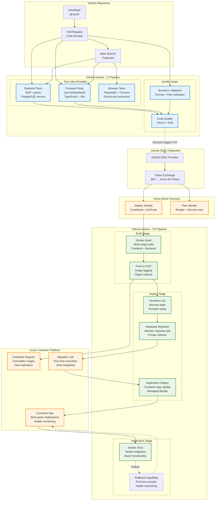
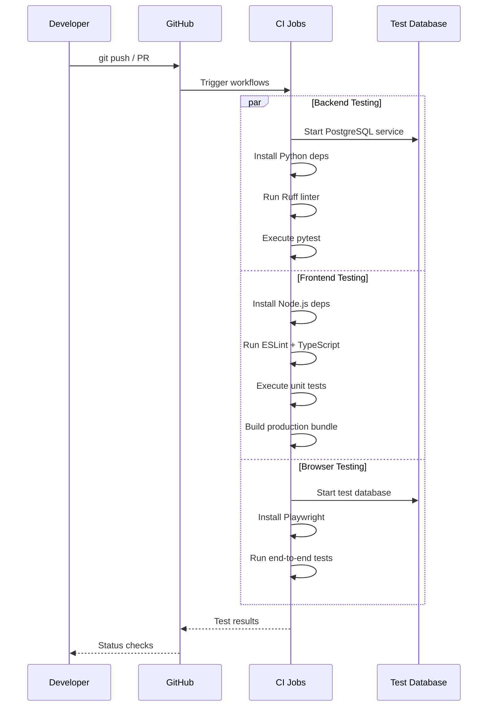
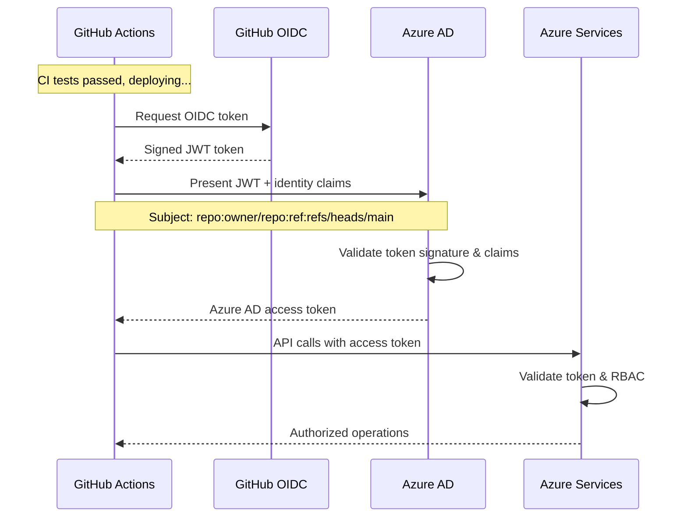
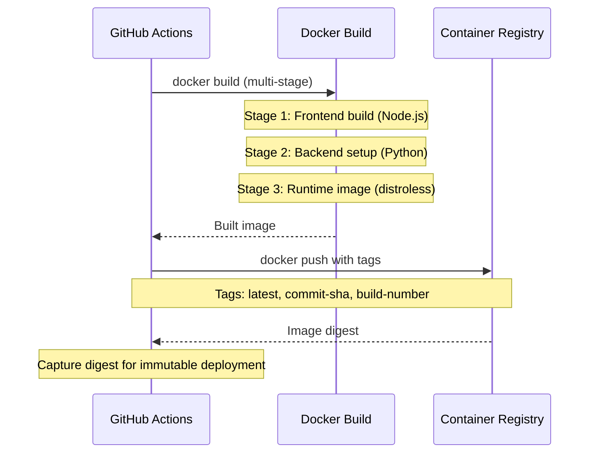
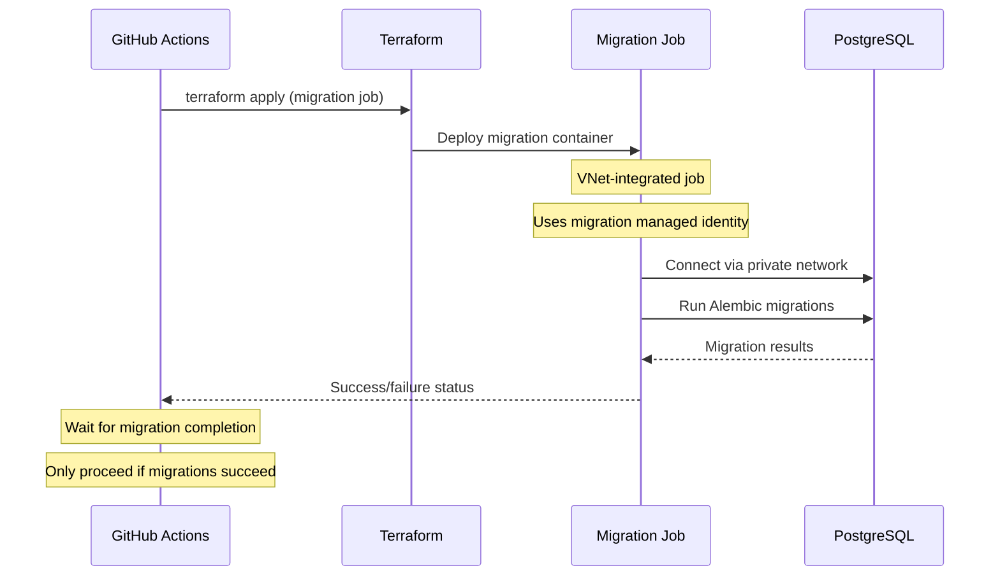
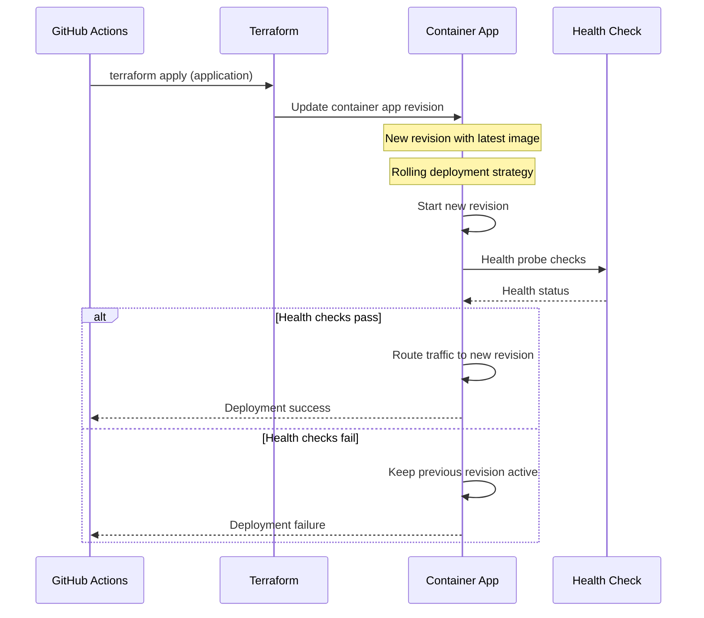
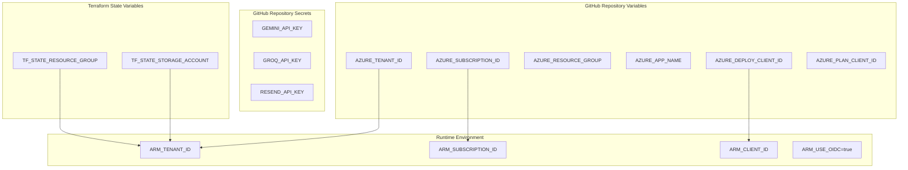
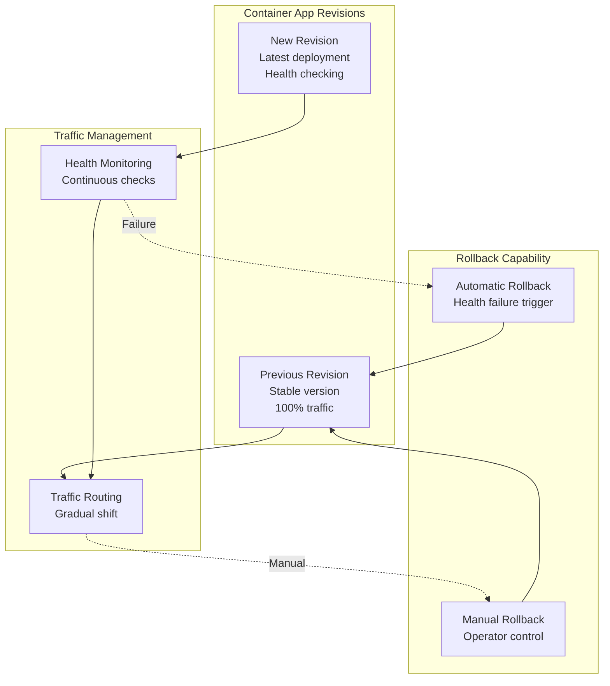
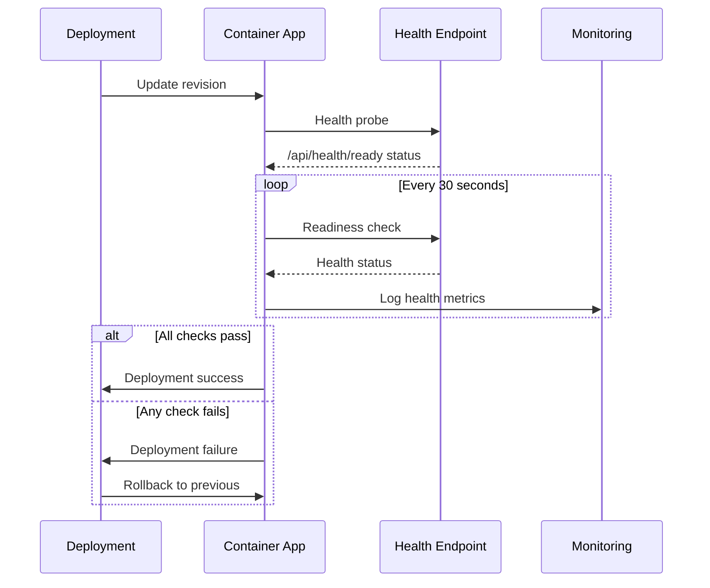
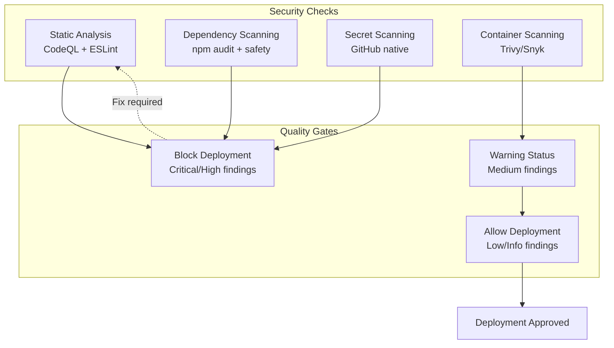

# CI/CD Pipeline Architecture

This document details the continuous integration and deployment pipeline for YounderChat, including GitHub Actions workflows, Azure OIDC federation, and deployment automation.

## CI/CD Pipeline Overview

YounderChat uses a comprehensive CI/CD pipeline built on GitHub Actions with Azure OIDC federation, providing secure, automated deployments with comprehensive testing and validation.

## Workflow Configurations

### Application Workflow (`application.yml`)

| Trigger | Jobs Executed | Purpose |
|---------|---------------|---------|
| **Pull Request** | backend-tests, frontend-tests, browser-tests | Quality validation |
| **Push to main** | All CI jobs + Deploy | Production deployment |
| **Manual dispatch** | Configurable operations | On-demand operations |

### Infrastructure Workflow (`infrastructure.yml`)

| Trigger | Jobs Executed | Purpose |
|---------|---------------|---------|
| **PR (infra/ changes)** | Terraform validation only | Infrastructure validation |
| **Manual dispatch** | Terraform plan/apply | Infrastructure changes |

## CI/CD Stages Details

### Stage 1: Continuous Integration

### Stage 2: Authentication & Authorization

### Stage 3: Build & Registry

### Stage 4: Database Migration

### Stage 5: Application Deployment

## OIDC Federation Configuration

### GitHub OIDC Setup

| Configuration | Value | Purpose |
|---------------|-------|---------|
| **Issuer URL** | `https://token.actions.githubusercontent.com` | GitHub's OIDC provider |
| **Audience** | `api://AzureADTokenExchange` | Azure-specific audience claim |
| **Subject Claim** | `repo:{owner}/{repo}:ref:refs/heads/main` | Repository and branch identification |
| **Thumbprint** | GitHub's certificate thumbprint | Trust verification |

### Azure AD Application Configuration

| Setting | Value | Security Benefit |
|---------|-------|------------------|
| **Application Type** | Service Principal | Automated access without user credentials |
| **Credential Type** | Federated credential | No stored secrets |
| **Issuer** | GitHub OIDC | Trusted external identity provider |
| **Subject Identifier** | Repository-specific | Scoped access per repository |

## Environment Configuration

### CI/CD Environment Variables

### Environment Protection Rules

| Environment | Protection Rules | Approval Required |
|-------------|------------------|------------------|
| **infra-plan** | Branch protection | No (automated) |
| **infra-deploy** | Branch protection + Manual approval | Yes (infrastructure changes) |
| **production** | Branch protection + Required reviews | No (automated after CI) |

## Deployment Strategies

### Blue-Green Deployment Model

### Deployment Flow

1. **New Revision Creation**: Deploy new container image as inactive revision
2. **Health Verification**: Run health checks against new revision
3. **Traffic Shifting**: Gradually route traffic from old to new revision
4. **Monitoring**: Continuous health and performance monitoring
5. **Cleanup**: Deactivate old revision after successful deployment

## Monitoring and Observability

### Pipeline Monitoring

| Metric | Source | Alert Threshold | Action |
|--------|--------|-----------------|---------|
| **Build Success Rate** | GitHub Actions | < 95% | Investigate failing tests |
| **Deployment Duration** | Workflow timing | > 20 minutes | Optimize deployment process |
| **Test Coverage** | Test reports | < 80% | Improve test coverage |
| **Security Scan Results** | Code scanning | High/Critical findings | Fix security issues |

### Deployment Health Checks

## Security in CI/CD

### Secrets Management

| Secret Type | Storage Location | Access Scope | Rotation |
|-------------|------------------|--------------|----------|
| **Azure Service Principal** | Federated identity (no secret) | Workflow-scoped | N/A |
| **API Keys** | GitHub repository secrets | Deploy workflow only | Manual |
| **Database Passwords** | Azure Key Vault | Runtime/migration only | Manual |
| **Container Registry** | Managed identity | Push/pull operations | N/A |

### Security Scanning

## Workflow Artifacts

### Build Artifacts

| Artifact | Purpose | Retention | Storage |
|----------|---------|-----------|---------|
| **Container Images** | Runtime deployment | 30 days | Azure Container Registry |
| **Test Reports** | Quality verification | 30 days | GitHub Actions |
| **Terraform Plans** | Infrastructure changes | 7 days | Workflow artifacts |
| **Security Scan Results** | Compliance evidence | 90 days | GitHub Security |

### Deployment Evidence

| Evidence Type | Content | Purpose |
|---------------|---------|---------|
| **Deployment Logs** | Complete deployment process | Audit trail |
| **Health Check Results** | Post-deployment verification | Success validation |
| **Rollback Procedures** | Emergency response steps | Incident response |
| **Performance Metrics** | Deployment impact assessment | Optimization |

---

*Content was rephrased for compliance with licensing restrictions*

For complete architecture, see [Azure Infrastructure](azure-infrastructure.md)  
For security details, see [Security Architecture](security-architecture.md)  
For network configuration, see [Network Topology](network-topology.md)