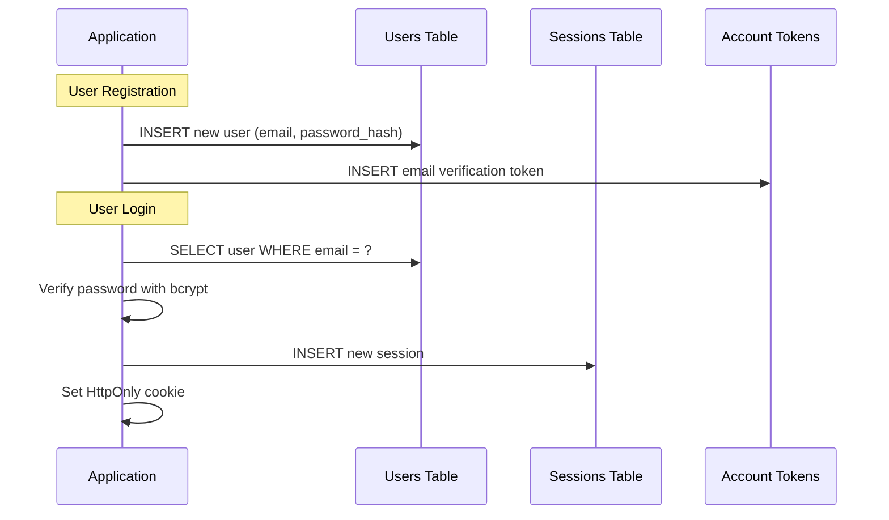
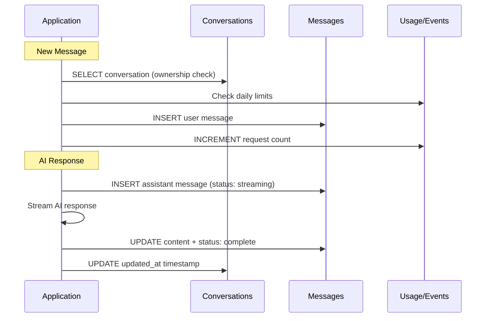
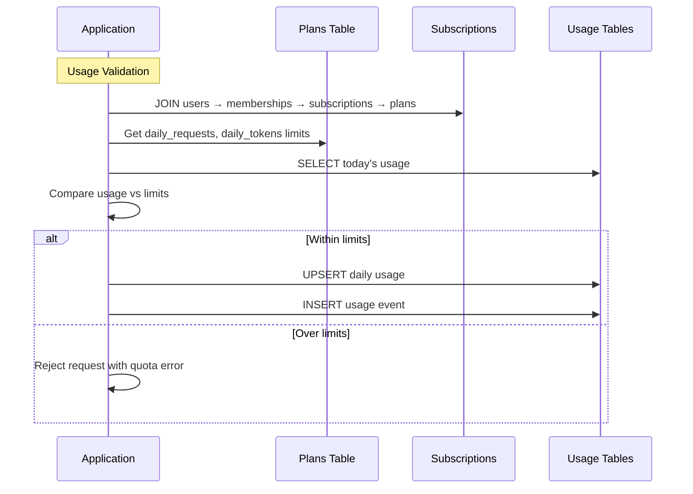

# Data Model Architecture

This document details the complete data model for YounderChat, including entity relationships, database schema, and data flow patterns within the PostgreSQL database.

## Database Schema Overview

YounderChat uses PostgreSQL 16 with a normalized relational schema designed for scalability, data integrity, and efficient querying patterns.

```mermaid
erDiagram
    User {
        string id PK "UUID primary key"
        string email UK "Unique email address"
        string name "Display name (80 chars)"
        string password_hash "bcrypt hashed password"
        string role "admin/user (default: user)"
        boolean active "Account status (default: true)"
        boolean verified_user "Email verification status"
        int email_verified_at "Verification timestamp"
        string bio "User biography (500 chars)"
        string timezone "Timezone (default: UTC)"
        string appearance "UI theme (system/light/dark)"
        string contrast "Contrast level (standard/high)"
        int created_at "Creation timestamp"
    }

    LoginSession {
        string token_hash PK "SHA-256 session token"
        string user_id FK "Reference to users.id"
        string csrf_hash "CSRF token hash"
        int created_at "Session creation time"
        int expires_at "Session expiration time"
        int last_active_at "Last activity timestamp"
        string source "Browser/client information"
    }

    Conversation {
        string id PK "UUID primary key"
        string user_id FK "Reference to users.id"
        string title "Conversation title (120 chars)"
        boolean archived "Archive status (default: false)"
        int created_at "Creation timestamp"
        int updated_at "Last modification timestamp"
    }

    Message {
        string id PK "UUID primary key"
        string conversation_id FK "Reference to conversations.id"
        string parent_id "Parent message for threading"
        string role "user/assistant/system"
        int ordinal "Message order in conversation"
        string content "Message text content"
        string status "complete/streaming/error"
        string model "AI model identifier"
        string request_id "Unique request identifier"
        int created_at "Creation timestamp"
        int updated_at "Last modification timestamp"
    }

    Plan {
        string id PK "Plan identifier (basic/pro/enterprise)"
        string name "Plan display name"
        int seats "Number of allowed users"
        int daily_requests "Daily request limit"
        int daily_tokens "Daily token limit"
        int retention_days "Data retention period"
        int storage_bytes "Storage limit in bytes"
        int version "Plan schema version"
    }

    Subscription {
        string id PK "UUID primary key"
        string owner_id FK "Reference to users.id (owner)"
        string plan_id FK "Reference to plans.id"
        string status "active/suspended/expired"
        int expires_at "Subscription expiration"
        int created_at "Creation timestamp"
    }

    Membership {
        string user_id PK,FK "Reference to users.id"
        string subscription_id FK "Reference to subscriptions.id"
    }

    Usage {
        string user_id PK,FK "Reference to users.id"
        string day PK "Date in YYYY-MM-DD format"
        int requests "Daily request count"
        int reserved_tokens "Reserved token count"
    }

    UsageEvent {
        string id PK "UUID primary key"
        string user_id FK "Reference to users.id"
        string subscription_id FK "Reference to subscriptions.id"
        string model "AI model used"
        int reserved_tokens "Tokens reserved for request"
        string status "pending/completed/failed"
        int created_at "Event timestamp"
    }

    Attachment {
        string id PK "UUID primary key"
        string user_id FK "Reference to users.id"
        string name "Original filename"
        string media_type "MIME type"
        bytes data "Binary file content"
        int created_at "Upload timestamp"
    }

    RateBucket {
        string key PK "Rate limit key"
        int count "Current count"
        int expires_at "Bucket expiration time"
    }

    Audit {
        string id PK "UUID primary key"
        string actor_id "User performing action"
        string target_id "Target of action"
        string action "Action description"
        int created_at "Event timestamp"
    }

    AccountToken {
        string token_hash PK "SHA-256 token hash"
        string user_id FK "Reference to users.id"
        string purpose "password_reset/email_verify/invitation"
        int expires_at "Token expiration time"
    }

    Invitation {
        string token_hash PK "SHA-256 invitation token"
        string subscription_id FK "Reference to subscriptions.id"
        string email "Invited email address"
        int expires_at "Invitation expiration"
        string status "pending/accepted/expired"
    }

    SchemaMigration {
        string id PK "UUID primary key"
        string from_revision "Previous Alembic revision"
        string to_revision "Target Alembic revision"
        string commit_sha "Git commit hash"
        string image "Container image used"
        int applied_at "Migration timestamp"
    }

    %% Primary relationships
    User ||--o{ LoginSession : "has sessions"
    User ||--o{ Conversation : "owns conversations"
    User ||--o{ Attachment : "owns attachments"
    User ||--o{ Usage : "tracks usage"
    User ||--o{ UsageEvent : "generates events"
    User ||--o{ AccountToken : "has tokens"
    User ||--o{ Audit : "subject of audit"
    User ||--o{ Subscription : "owns subscriptions"
    User ||--o{ Membership : "member of subscriptions"

    Conversation ||--o{ Message : "contains messages"
    Message ||--o{ Message : "parent-child threading"

    Plan ||--o{ Subscription : "defines subscription"
    Subscription ||--o{ Membership : "has members"
    Subscription ||--o{ UsageEvent : "tracks usage"
    Subscription ||--o{ Invitation : "manages invitations"
```



## Table Details and Constraints

### Core User Management

#### Users Table
| Column | Type | Constraints | Purpose |
|--------|------|-------------|---------|
| `id` | VARCHAR(36) | PRIMARY KEY | UUID identifier |
| `email` | VARCHAR(254) | UNIQUE, NOT NULL | Authentication identifier |
| `name` | VARCHAR(80) | NOT NULL | Display name |
| `password_hash` | TEXT | NOT NULL | bcrypt password hash |
| `role` | VARCHAR(16) | DEFAULT 'user' | Access role (admin/user) |
| `active` | BOOLEAN | DEFAULT true | Account status |
| `verified_user` | BOOLEAN | DEFAULT false | Email verification |
| `created_at` | INTEGER | DEFAULT now() | Creation timestamp |

#### Sessions Table (LoginSession)
| Column | Type | Constraints | Purpose |
|--------|------|-------------|---------|
| `token_hash` | VARCHAR(64) | PRIMARY KEY | Session identifier |
| `user_id` | VARCHAR(36) | FK → users.id, CASCADE DELETE | Session owner |
| `csrf_hash` | VARCHAR(64) | NOT NULL | CSRF protection |
| `expires_at` | INTEGER | INDEXED | Session expiration |
| `last_active_at` | INTEGER | DEFAULT now() | Activity tracking |

**Indexes**: 
- `ix_single_user_session` (user_id) - UNIQUE for single-session enforcement
- `ix_sessions_expires_at` (expires_at) - Cleanup queries

### Content Management

#### Conversations Table
| Column | Type | Constraints | Purpose |
|--------|------|-------------|---------|
| `id` | VARCHAR(36) | PRIMARY KEY | UUID identifier |
| `user_id` | VARCHAR(36) | FK → users.id, CASCADE DELETE | Ownership |
| `title` | VARCHAR(120) | DEFAULT 'New conversation' | Display title |
| `archived` | BOOLEAN | DEFAULT false | Archive status |
| `updated_at` | INTEGER | DEFAULT now() | Sort/pagination |

**Indexes**: 
- `ix_conversation_owner_order` (user_id, updated_at, id) - Efficient pagination

#### Messages Table
| Column | Type | Constraints | Purpose |
|--------|------|-------------|---------|
| `id` | VARCHAR(36) | PRIMARY KEY | UUID identifier |
| `conversation_id` | VARCHAR(36) | FK → conversations.id, CASCADE DELETE | Grouping |
| `parent_id` | VARCHAR(36) | NULLABLE | Threading support |
| `role` | VARCHAR(16) | NOT NULL | user/assistant/system |
| `ordinal` | INTEGER | NOT NULL | Message ordering |
| `content` | TEXT | DEFAULT '' | Message content |
| `status` | VARCHAR(16) | DEFAULT 'complete' | Streaming status |
| `model` | VARCHAR(120) | DEFAULT '' | AI model used |
| `request_id` | VARCHAR(36) | NULLABLE | Deduplication |

**Constraints**: 
- UNIQUE (conversation_id, request_id) - Prevent duplicate requests
- UNIQUE (conversation_id, ordinal) - Enforce message order

**Indexes**: 
- `ix_message_branch_order` (conversation_id, ordinal) - Message retrieval

### Plan and Usage Management

#### Plans Table
| Column | Type | Constraints | Purpose |
|--------|------|-------------|---------|
| `id` | VARCHAR(16) | PRIMARY KEY | Plan identifier |
| `name` | VARCHAR(40) | NOT NULL | Display name |
| `seats` | INTEGER | NOT NULL | User limit |
| `daily_requests` | INTEGER | NOT NULL | Request quota |
| `daily_tokens` | INTEGER | NOT NULL | Token quota |
| `retention_days` | INTEGER | NULLABLE | Data retention |
| `storage_bytes` | INTEGER | NOT NULL | Storage limit |

#### Usage Table (Daily Aggregation)
| Column | Type | Constraints | Purpose |
|--------|------|-------------|---------|
| `user_id` | VARCHAR(36) | FK → users.id, CASCADE DELETE | User tracking |
| `day` | VARCHAR(10) | NOT NULL | YYYY-MM-DD format |
| `requests` | INTEGER | DEFAULT 0 | Daily request count |
| `reserved_tokens` | INTEGER | DEFAULT 0 | Token reservations |

**Primary Key**: (user_id, day) - Composite key for daily tracking

#### Usage Events Table (Detailed Tracking)
| Column | Type | Constraints | Purpose |
|--------|------|-------------|---------|
| `id` | VARCHAR(36) | PRIMARY KEY | Event identifier |
| `user_id` | VARCHAR(36) | FK → users.id | User reference |
| `subscription_id` | VARCHAR(36) | FK → subscriptions.id | Billing context |
| `model` | VARCHAR(120) | NOT NULL | AI model used |
| `reserved_tokens` | INTEGER | NOT NULL | Token allocation |
| `status` | VARCHAR(16) | DEFAULT 'pending' | Event status |

**Indexes**: 
- `ix_usage_events_user_id` (user_id) - User usage queries
- `ix_usage_events_subscription_id` (subscription_id) - Subscription analytics
- `ix_usage_events_created_at` (created_at) - Time-based queries

## Data Flow Patterns

### User Registration and Authentication



### Chat Message Flow



### Plan and Usage Tracking



## Database Performance Considerations

### Indexing Strategy

| Table | Index | Columns | Purpose |
|-------|-------|---------|---------|
| conversations | owner_order | user_id, updated_at, id | Pagination queries |
| messages | branch_order | conversation_id, ordinal | Message retrieval |
| sessions | expires_at | expires_at | Session cleanup |
| sessions | single_user | user_id | Single session enforcement |
| usage_events | user_created | user_id, created_at | Usage analytics |

### Query Optimization

#### Conversation List (Paginated)
```sql
SELECT id, title, updated_at 
FROM conversations 
WHERE user_id = ? AND updated_at < ? 
ORDER BY updated_at DESC, id DESC 
LIMIT 20;
```

#### Message Thread Retrieval
```sql
SELECT role, content, created_at 
FROM messages 
WHERE conversation_id = ? 
ORDER BY ordinal ASC;
```

#### Daily Usage Check
```sql
SELECT requests, reserved_tokens 
FROM usage 
WHERE user_id = ? AND day = CURRENT_DATE;
```

## Data Retention and Cleanup

### Automated Cleanup Patterns

| Data Type | Retention Policy | Cleanup Method |
|-----------|------------------|----------------|
| **Expired Sessions** | Immediate cleanup | Cron job DELETE WHERE expires_at < now() |
| **Rate Buckets** | Immediate cleanup | Cron job DELETE WHERE expires_at < now() |
| **Account Tokens** | Immediate cleanup | Cron job DELETE WHERE expires_at < now() |
| **Usage Events** | Plan-defined retention | Scheduled cleanup per plan.retention_days |
| **Audit Logs** | 90 days | Scheduled deletion |

### Data Migration History

The `schema_migrations` table tracks all database schema changes:

| Column | Purpose | Example Value |
|--------|---------|---------------|
| `from_revision` | Previous Alembic revision | `abc123def456` |
| `to_revision` | Applied revision | `def456ghi789` |
| `commit_sha` | Git commit of migration | `a1b2c3d4e5f6...` |
| `image` | Container image used | `bychat.azurecr.io/app:v1.2.3` |
| `applied_at` | Migration timestamp | `1640995200` |

## Database Security Model

### Connection Security

| User Role | Database User | Permissions | Usage |
|-----------|---------------|-------------|-------|
| **Administrator** | `chatadmin` | Full schema access | Migrations, maintenance |
| **Application** | `chat_runtime` | CRUD on all tables | Runtime operations |
| **Observer** | `chat_observer` | SELECT only | Analytics, monitoring |

### Row-Level Security Patterns

While not implemented at the database level, application-level security ensures:

- **Conversation Ownership**: All queries filtered by `user_id`
- **Message Access**: Via conversation ownership chain
- **Attachment Access**: Direct `user_id` ownership
- **Usage Data**: Scoped to requesting user
- **Admin Operations**: Role-based access controls

---

*Content was rephrased for compliance with licensing restrictions*

For complete architecture, see [Azure Infrastructure](azure-infrastructure.md)  
For application flow, see [User Workflow](user-workflow.md)  
For system design, see [System Architecture](../architecture.md)