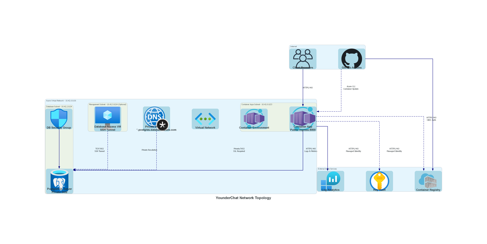

# Network Topology Architecture

This document details the network architecture of YounderChat's Azure deployment, including virtual network design, subnet configuration, network security groups, and private DNS resolution.

## Network Architecture Overview

The YounderChat application uses a hub-and-spoke network architecture within a single Virtual Network, with dedicated subnets for different service tiers and comprehensive network security controls.



> *Generated diagram — run `python tools/generate_all_diagrams.py` to refresh*

## Virtual Network Configuration

### Primary Virtual Network
- **Name**: `{name}-vnet`
- **Address Space**: `10.42.0.0/16` (65,536 addresses)
- **Region**: Central US
- **DNS Servers**: Azure-provided DNS with private DNS zone integration

### Subnet Allocation Strategy

| Subnet | CIDR Block | Available IPs | Service Delegation | Purpose |
|--------|------------|---------------|-------------------|---------|
| **container-apps** | `10.42.0.0/23` | 510 | Microsoft.App/environments | Container App Environment |
| **postgresql** | `10.42.2.0/24` | 254 | Microsoft.DBforPostgreSQL/flexibleServers | PostgreSQL Flexible Server |
| **management** | `10.42.3.0/24` | 254 | None | Optional database access VM |

*Note: Management subnet is created only when `db_access.enabled = true`*

## Network Security Groups

### Database Subnet NSG Rules


> *NSG rules are shown in the main network topology diagram above*

### NSG Rules Details

| Rule Name | Priority | Direction | Source | Destination | Protocol | Port | Action | Purpose |
|-----------|----------|-----------|--------|-------------|----------|------|--------|---------|
| AllowAppPostgres | 100 | Inbound | 10.42.0.0/23 | 10.42.2.0/24 | TCP | 5432 | Allow | Container App → PostgreSQL |
| AllowPostgresInternal | 110 | Inbound | 10.42.2.0/24 | 10.42.2.0/24 | * | * | Allow | Internal database communication |
| AllowManagementPostgres | 120 | Inbound | 10.42.3.0/24 | 10.42.2.0/24 | TCP | 5432 | Allow | Management VM → PostgreSQL (optional) |
| DenyOtherInbound | 200 | Inbound | * | * | * | * | Deny | Default deny all other traffic |

## Private DNS Configuration

### Private DNS Zone
- **Zone Name**: `{name}.postgres.database.azure.com`
- **Purpose**: Resolve PostgreSQL Flexible Server private endpoints
- **VNet Link**: Linked to main virtual network for resolution

### DNS Resolution Flow
1. Container App resolves PostgreSQL FQDN
2. Azure DNS queries private DNS zone
3. Private DNS zone returns private IP address
4. Connection established over private network

## Traffic Flow Analysis

### Inbound Traffic Flows


> *Inbound traffic flows are shown in the main network topology diagram above*

### Outbound Traffic Flows


> *Outbound traffic flows are shown in the main network topology diagram above*

## IP Address Allocation

### Address Space Utilization

| Network Segment | CIDR | First IP | Last IP | Broadcast | Available | Used |
|-----------------|------|----------|---------|-----------|-----------|------|
| **VNet Total** | 10.42.0.0/16 | 10.42.0.0 | 10.42.255.255 | N/A | 65,536 | ~20 |
| **Container Apps** | 10.42.0.0/23 | 10.42.0.1 | 10.42.1.254 | 10.42.1.255 | 510 | ~5 |
| **Database** | 10.42.2.0/24 | 10.42.2.1 | 10.42.2.254 | 10.42.2.255 | 254 | ~5 |
| **Management** | 10.42.3.0/24 | 10.42.3.1 | 10.42.3.254 | 10.42.3.255 | 254 | ~2 |

*Note: Azure reserves the first 4 and last 1 IP addresses in each subnet*

## Service Endpoints and Private Links

### Service Integration

| Service | Connection Type | Network Path | Authentication |
|---------|----------------|--------------|----------------|
| **PostgreSQL** | Private Endpoint | 10.42.2.0/24 | SSL/TLS + Username/Password |
| **Key Vault** | Service Endpoint | Internet via Azure Backbone | Managed Identity |
| **Container Registry** | Service Endpoint | Internet via Azure Backbone | Managed Identity |
| **Log Analytics** | Public Endpoint | Internet | System-assigned Identity |

### Private Endpoint Configuration
- **PostgreSQL**: Deployed with private endpoint in database subnet
- **DNS Resolution**: Handled by private DNS zone
- **SSL/TLS**: Enforced for all database connections

## Network Monitoring and Troubleshooting

### Connectivity Testing

```bash
# From Container App to PostgreSQL (internal connectivity)
telnet {postgresql-fqdn} 5432

# DNS resolution test
nslookup {postgresql-fqdn}

# SSL certificate verification
openssl s_client -connect {postgresql-fqdn}:5432
```

### Common Network Issues

| Issue | Symptoms | Resolution |
|-------|----------|------------|
| **Database Connection Timeout** | App can't reach PostgreSQL | Check NSG rules, verify private DNS |
| **DNS Resolution Failure** | PostgreSQL FQDN not resolving | Verify private DNS zone VNet link |
| **SSL/TLS Handshake Failure** | Connection drops after TCP connect | Check PostgreSQL SSL configuration |
| **Managed Identity Access Denied** | 403 errors accessing Key Vault | Verify RBAC role assignments |

## Network Security Best Practices

### Implemented Security Controls
- **Private Database Access**: No public IP, private subnet only
- **Network Segmentation**: Dedicated subnets for different tiers
- **Principle of Least Privilege**: NSG rules allow only required traffic
- **SSL/TLS Encryption**: All database connections encrypted
- **Managed Identity**: Eliminates stored credentials

### Security Monitoring
- **NSG Flow Logs**: Can be enabled for security auditing
- **Azure Monitor**: Network performance and security metrics
- **Log Analytics**: Centralized logging for security events

---

*Content was rephrased for compliance with licensing restrictions*

For infrastructure overview, see [Azure Infrastructure](azure-infrastructure.md)  
For security architecture, see [Security Architecture](security-architecture.md)  
For complete system architecture, see [System Architecture](../architecture.md)