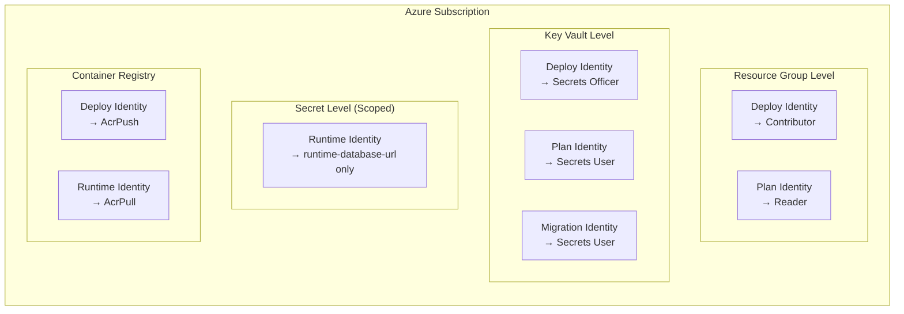
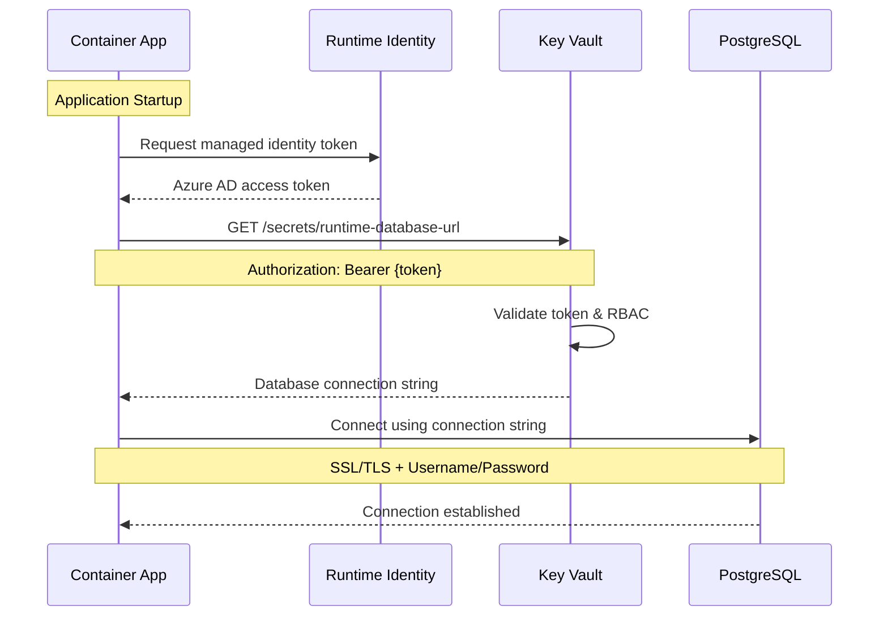
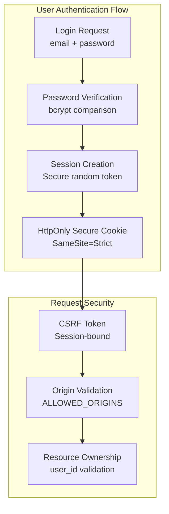
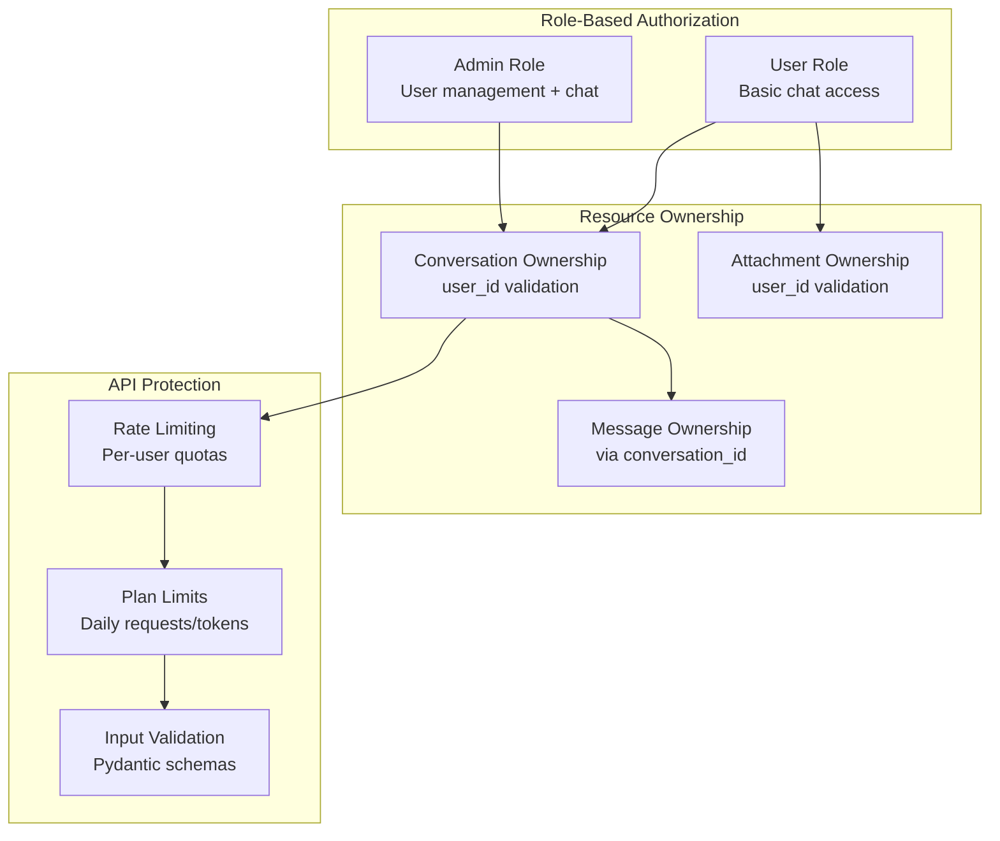
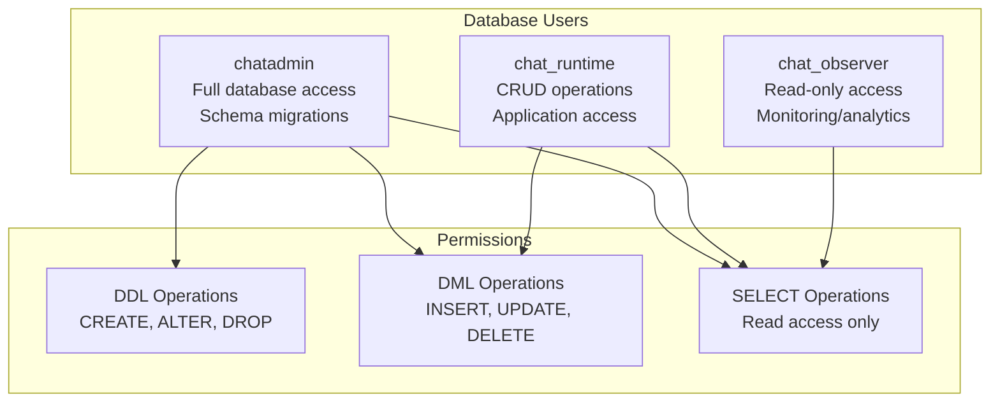
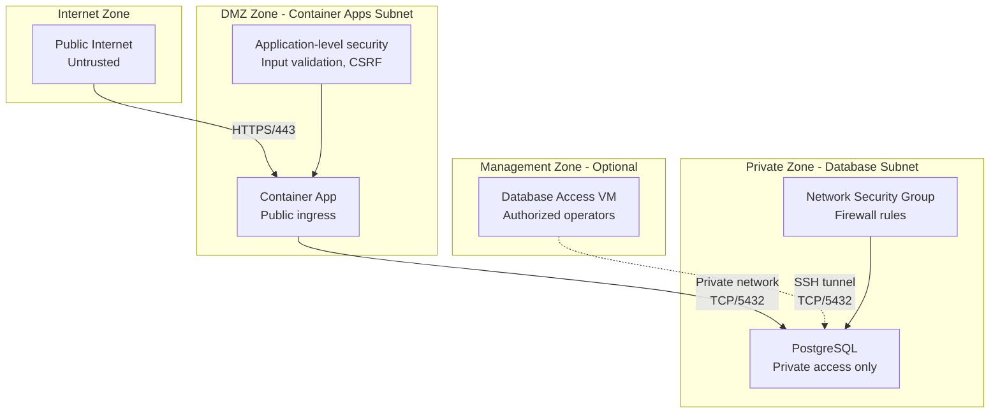

# Security Architecture

This document details the security architecture of YounderChat, including identity management, access controls, secret management, and security boundaries within the Azure environment.

## Security Architecture Overview

YounderChat implements a comprehensive security model based on Azure managed identities, Key Vault secret management, role-based access control (RBAC), and network security boundaries.

```mermaid
graph TB
    subgraph "GitHub Identity"
        GITHUB["GitHub Actions"]
        OIDC["GitHub OIDC Provider"]
    end

    subgraph "Azure Active Directory"
        TENANT["Azure AD Tenant"]
        DEPLOY_MI["Deploy Identity<br/>Contributor + AcrPush + ContainerApp"]
        PLAN_MI["Plan Identity<br/>Reader + Key Vault Secrets User"]
        RUNTIME_MI["Runtime Identity<br/>AcrPull + Key Vault Secrets User"]
        MIGRATION_MI["Migration Identity<br/>Key Vault Secrets User"]
    end

    subgraph "Azure Key Vault - RBAC Enabled"
        subgraph "Secrets"
            DB_SECRET["database-url<br/>(Admin Connection)"]
            RUNTIME_DB["runtime-database-url<br/>(App Connection)"]
            OBSERVER_DB["observer-database-url<br/>(Read-only)"]
            GEMINI_KEY["gemini-api-key<br/>(Optional)"]
            GROQ_KEY["groq-api-key<br/>(Optional)"]
            RESEND_KEY["resend-api-key<br/>(Optional)"]
        end
        
        subgraph "Access Policies"
            RBAC_DEPLOY["Deploy: Key Vault Secrets Officer"]
            RBAC_PLAN["Plan: Key Vault Secrets User"]
            RBAC_RUNTIME["Runtime: Key Vault Secrets User<br/>(runtime-database-url only)"]
            RBAC_MIGRATION["Migration: Key Vault Secrets User"]
        end
    end

    subgraph "Container Platform"
        ACR["Container Registry<br/>Admin Disabled"]
        CA["Container App<br/>User-Assigned MI"]
        MIGRATION_JOB["Migration Job<br/>User-Assigned MI"]
    end

    subgraph "Database Layer"
        PG["PostgreSQL Flexible Server<br/>Private Network Only"]
        subgraph "Database Users"
            ADMIN_USER["chatadmin<br/>Full Access"]
            RUNTIME_USER["chat_runtime<br/>CRUD Operations"]
            OBSERVER_USER["chat_observer<br/>Read-Only"]
        end
    end

    subgraph "Application Layer"
        subgraph "Authentication"
            SESSION["Session Cookies<br/>HttpOnly + Secure"]
            CSRF["CSRF Tokens<br/>Session-bound"]
            PASSWORD["Password Hashing<br/>bcrypt"]
        end
        
        subgraph "Authorization"
            RBAC_APP["Role-Based Access<br/>admin/user"]
            OWNERSHIP["Resource Ownership<br/>user_id validation"]
        end
    end

    %% Identity flows
    GITHUB --> OIDC
    OIDC --> TENANT
    TENANT --> DEPLOY_MI
    TENANT --> PLAN_MI
    TENANT --> RUNTIME_MI
    TENANT --> MIGRATION_MI

    %% RBAC assignments
    DEPLOY_MI -.->|"Secrets Officer"| RBAC_DEPLOY
    PLAN_MI -.->|"Secrets User"| RBAC_PLAN
    RUNTIME_MI -.->|"Secrets User (Scoped)"| RBAC_RUNTIME
    MIGRATION_MI -.->|"Secrets User"| RBAC_MIGRATION

    %% Secret access flows
    RBAC_DEPLOY --> DB_SECRET
    RBAC_DEPLOY --> RUNTIME_DB
    RBAC_DEPLOY --> OBSERVER_DB
    RBAC_DEPLOY --> GEMINI_KEY
    RBAC_DEPLOY --> GROQ_KEY
    RBAC_DEPLOY --> RESEND_KEY
    
    RBAC_RUNTIME --> RUNTIME_DB
    RBAC_MIGRATION --> DB_SECRET
    RBAC_MIGRATION --> RUNTIME_DB

    %% Service access
    RUNTIME_MI -.->|"AcrPull"| ACR
    CA -.->|"Managed Identity"| RUNTIME_MI
    MIGRATION_JOB -.->|"Managed Identity"| MIGRATION_MI

    %% Database connections
    RUNTIME_DB -.->|"Connection String"| RUNTIME_USER
    DB_SECRET -.->|"Connection String"| ADMIN_USER
    OBSERVER_DB -.->|"Connection String"| OBSERVER_USER

    %% Application security
    CA --> SESSION
    CA --> CSRF
    CA --> PASSWORD
    CA --> RBAC_APP
    CA --> OWNERSHIP

    classDef identity fill:#e3f2fd,stroke:#1976d2,stroke-width:2px
    classDef secret fill:#fff3e0,stroke:#f57c00,stroke-width:2px
    classDef security fill:#e8f5e8,stroke:#388e3c,stroke-width:2px

    class DEPLOY_MI,PLAN_MI,RUNTIME_MI,MIGRATION_MI identity
    class DB_SECRET,RUNTIME_DB,OBSERVER_DB,GEMINI_KEY,GROQ_KEY,RESEND_KEY secret
    class SESSION,CSRF,PASSWORD,RBAC_APP,OWNERSHIP security
```

## Identity and Access Management

### Managed Identity Configuration

| Identity | Type | Purpose | Scope |
|----------|------|---------|-------|
| **Deploy Identity** | User-assigned | CI/CD deployment operations | Subscription-level Contributor, ACR push, Container App management |
| **Plan Identity** | User-assigned | Terraform planning operations | Resource Group Reader, Key Vault Secrets User |
| **Runtime Identity** | User-assigned | Application runtime access | Scoped to specific secrets, ACR pull |
| **Migration Identity** | User-assigned | Database schema migrations | Database connection secrets only |

### Role-Based Access Control (RBAC)

### RBAC Assignments Details

| Principal | Resource | Role | Justification |
|-----------|----------|------|---------------|
| Deploy Identity | Resource Group | Contributor | Full deployment automation |
| Deploy Identity | Container Registry | AcrPush | Image publishing in CI/CD |
| Deploy Identity | Key Vault | Key Vault Secrets Officer | Manage deployment secrets |
| Plan Identity | Resource Group | Reader | Read resources for Terraform planning |
| Plan Identity | Key Vault | Key Vault Secrets User | Read secrets for planning |
| Runtime Identity | Container Registry | AcrPull | Pull application images |
| Runtime Identity | Key Vault (Scoped) | Key Vault Secrets User | Access runtime database connection only |
| Migration Identity | Key Vault | Key Vault Secrets User | Access database connections for migrations |

## Secret Management Architecture

### Key Vault Configuration
- **SKU**: Standard (cost-optimized for development)
- **Access Model**: RBAC-based (modern Azure security model)
- **Soft Delete**: 7-day retention (compliance and recovery)
- **Purge Protection**: Enabled (prevent permanent deletion)

### Secrets Inventory

| Secret Name | Purpose | Access Scope | Rotation |
|-------------|---------|--------------|----------|
| `database-url` | Admin database connection | Deploy, Migration identities | Manual |
| `runtime-database-url` | Application database connection | Runtime identity only | Manual |
| `observer-database-url` | Read-only database connection | Optional observer access | Manual |
| `gemini-api-key` | Google Gemini API access | Runtime identity (if configured) | Manual |
| `groq-api-key` | Groq API access | Runtime identity (if configured) | Manual |
| `resend-api-key` | Email service integration | Runtime identity (if enabled) | Manual |

### Secret Access Flow

## Application-Level Security

### Authentication Architecture

### Session Security Configuration

| Setting | Value | Security Benefit |
|---------|-------|------------------|
| **HttpOnly** | `true` | Prevents XSS access to session cookies |
| **Secure** | `true` | HTTPS-only cookie transmission |
| **SameSite** | `Strict` | CSRF protection |
| **Session Lifetime** | Configurable | Limits exposure window |
| **CSRF Token** | Session-bound | Prevents cross-site request forgery |

### Authorization Model

## Database Security

### Connection Security

| Layer | Security Control | Implementation |
|-------|-----------------|----------------|
| **Network** | Private subnet only | No public IP, NSG protection |
| **Transport** | SSL/TLS encryption | Required for all connections |
| **Authentication** | Username/password | Strong generated passwords |
| **Authorization** | Database role separation | Least-privilege access |

### Database User Roles

### Database Connection Strings

| User | Purpose | Access Pattern | Secret Location |
|------|---------|----------------|-----------------|
| `chatadmin` | Migrations, admin operations | CI/CD only | `database-url` in Key Vault |
| `chat_runtime` | Application operations | Runtime only | `runtime-database-url` in Key Vault |
| `chat_observer` | Read-only monitoring | Optional | `observer-database-url` in Key Vault |

## Network Security Boundaries

### Security Zones

## Security Monitoring and Compliance

### Security Logging

| Event Type | Log Destination | Retention | Purpose |
|------------|-----------------|-----------|---------|
| **Authentication Events** | Application logs → Log Analytics | 30 days | Security auditing |
| **Authorization Failures** | Application logs → Log Analytics | 30 days | Access monitoring |
| **Key Vault Access** | Azure Monitor | 30 days | Secret access tracking |
| **NSG Flow Logs** | Optional configuration | Configurable | Network security monitoring |

### Compliance Features

| Control | Implementation | Compliance Benefit |
|---------|----------------|-------------------|
| **Data Encryption** | SSL/TLS, AES-256 | Data protection in transit/rest |
| **Identity Management** | Azure AD, Managed Identity | Centralized identity controls |
| **Access Logging** | Comprehensive audit trails | Accountability and monitoring |
| **Network Segmentation** | VNet, subnets, NSGs | Defense in depth |
| **Secret Management** | Key Vault, RBAC | Centralized secret lifecycle |

## Security Best Practices Implemented

### Azure Security Recommendations
- ✅ **Managed Identities**: No stored credentials in code
- ✅ **Key Vault Integration**: Centralized secret management
- ✅ **Private Networking**: Database isolated from internet
- ✅ **RBAC**: Principle of least privilege
- ✅ **SSL/TLS Everywhere**: Encrypted communications
- ✅ **Network Security Groups**: Firewall protection
- ✅ **Audit Logging**: Comprehensive security monitoring

### Application Security Measures
- ✅ **Password Hashing**: bcrypt with appropriate cost
- ✅ **Session Security**: HttpOnly, Secure, SameSite cookies
- ✅ **CSRF Protection**: Token-based validation
- ✅ **Input Validation**: Pydantic schema validation
- ✅ **Resource Ownership**: User-scoped access controls
- ✅ **Rate Limiting**: Abuse prevention
- ✅ **Plan Enforcement**: Usage quota controls

---

*Content was rephrased for compliance with licensing restrictions*

For network details, see [Network Topology](network-topology.md)  
For infrastructure overview, see [Azure Infrastructure](azure-infrastructure.md)  
For CI/CD security, see [CI/CD Pipeline](cicd-pipeline.md)