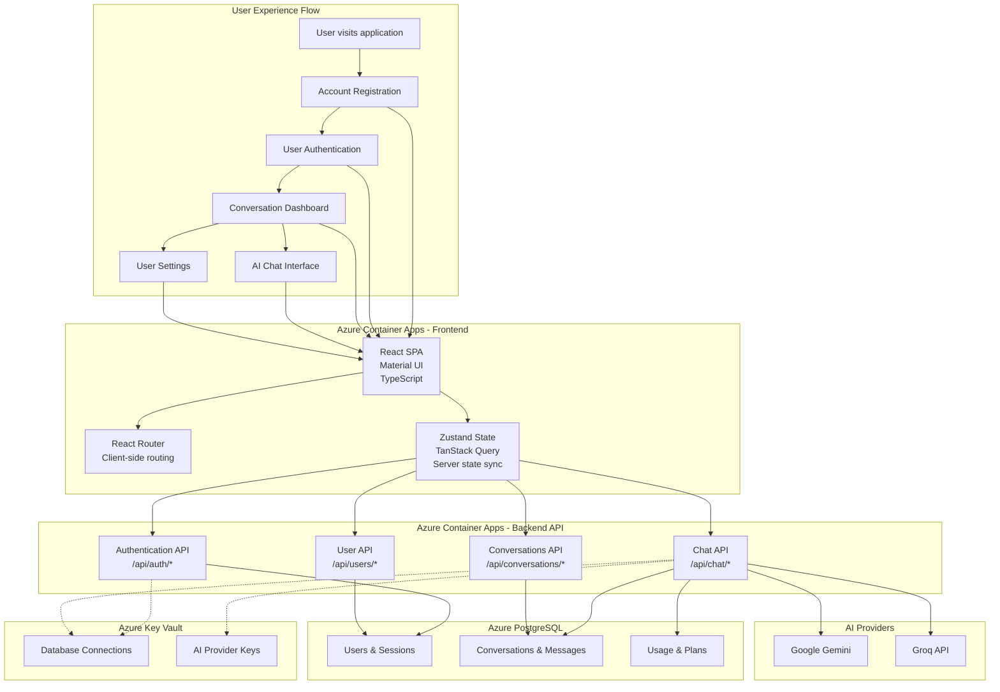
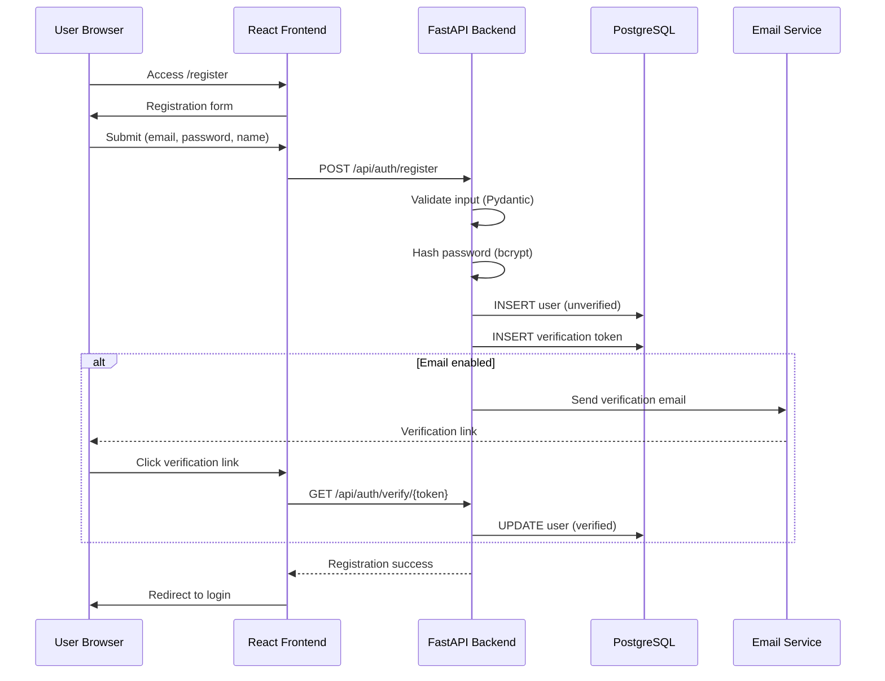
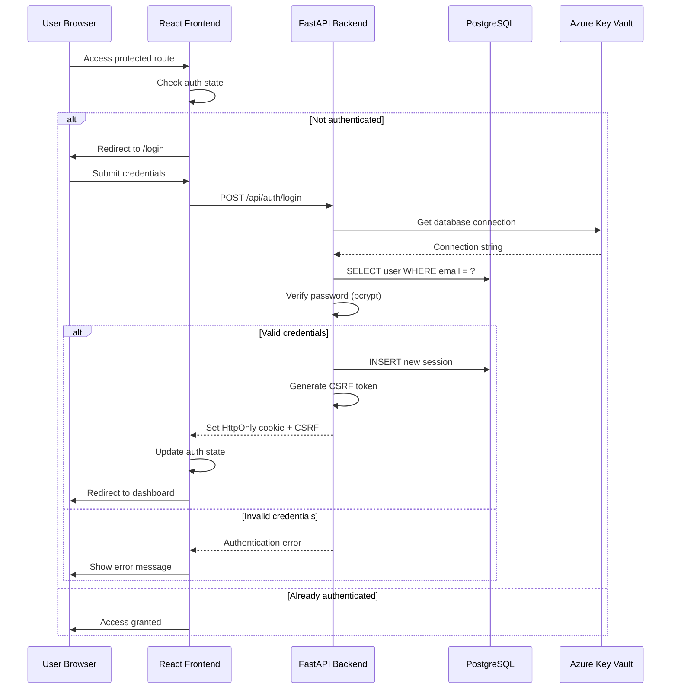
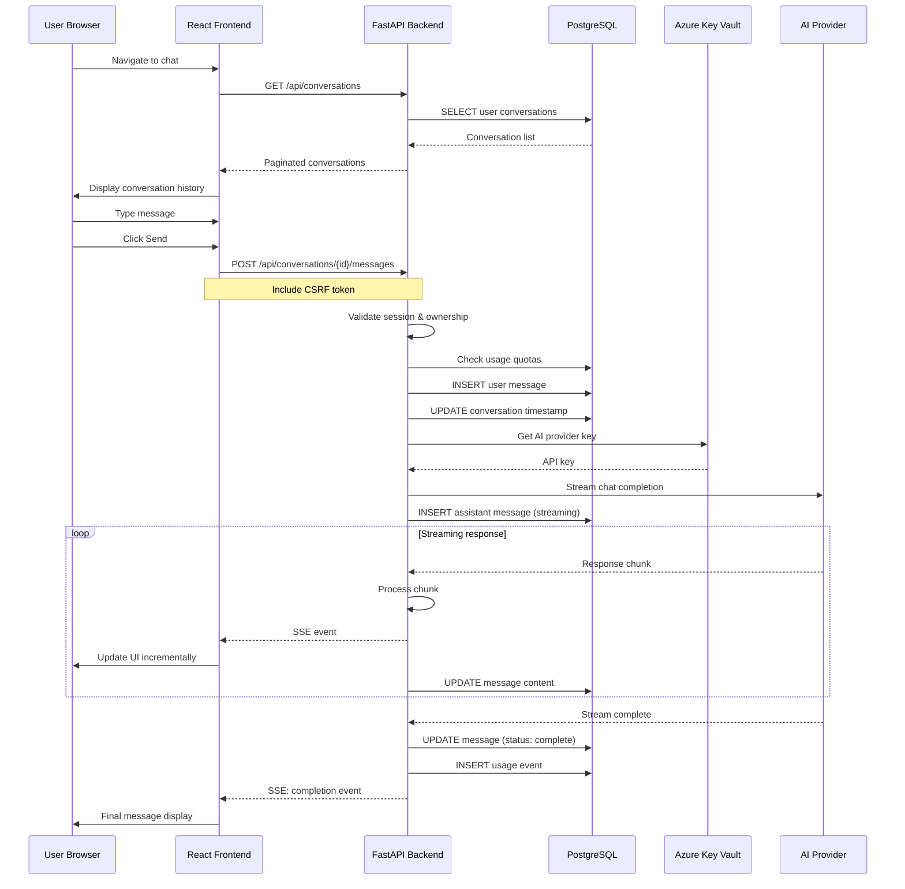
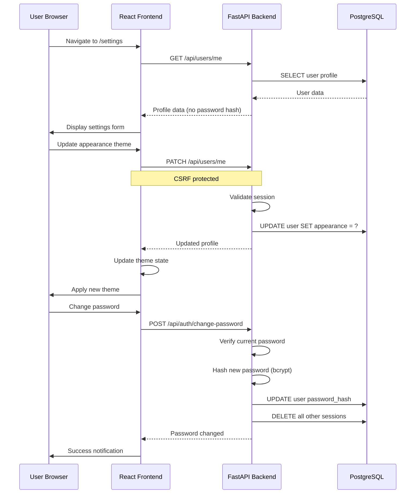
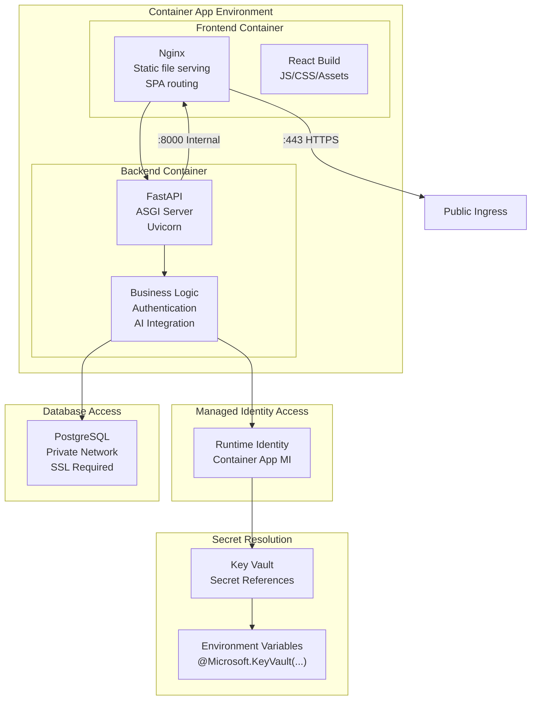
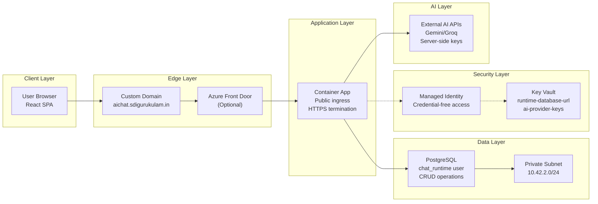
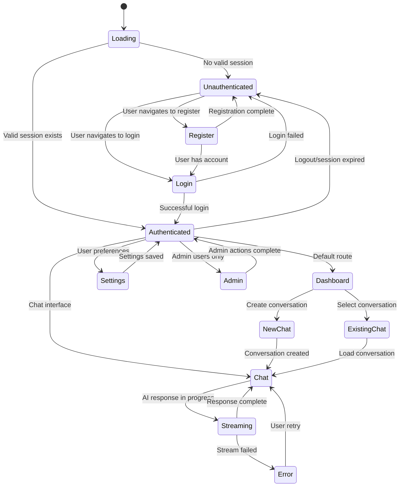
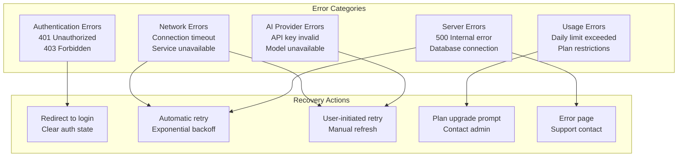

# User Workflow Architecture

This document details the complete user journey through YounderChat, from registration to AI-powered conversations, including all Azure service touchpoints and system interactions.

## User Journey Overview

The user workflow encompasses account management, authentication, conversation management, and AI interactions, all orchestrated through Azure Container Apps with secure backend services.

## Detailed User Workflows

### Account Registration and Verification

### User Authentication Flow

### Chat Conversation Flow

### Settings and Profile Management

## Azure Service Integration Points

### Container Apps Integration

### Data Flow Through Azure Services

## User Experience States

### Application State Management

### Error Handling and Recovery

## Performance and Scalability Patterns

### Frontend Performance

| Optimization | Implementation | Benefit |
|--------------|----------------|---------|
| **Code Splitting** | React.lazy() + Suspense | Smaller initial bundle |
| **Query Caching** | TanStack Query | Reduced API calls |
| **Virtual Scrolling** | Message list optimization | Handle large conversations |
| **Optimistic Updates** | UI updates before API confirmation | Perceived performance |
| **Progressive Loading** | Lazy load conversation history | Faster initial load |

### Backend Performance

| Optimization | Implementation | Benefit |
|--------------|----------------|---------|
| **Connection Pooling** | SQLAlchemy pool configuration | Efficient DB connections |
| **Query Optimization** | Indexed queries, pagination | Fast data retrieval |
| **Streaming Responses** | FastAPI StreamingResponse | Real-time AI output |
| **Rate Limiting** | Per-user request quotas | Fair resource usage |
| **Async Processing** | Python asyncio patterns | Non-blocking operations |

### Azure Integration Benefits

| Service | Performance Benefit | Scalability Feature |
|---------|---------------------|-------------------|
| **Container Apps** | Auto-scaling 0-2 replicas | Pay-per-use scaling |
| **PostgreSQL** | Burstable performance | Credit accumulation |
| **Key Vault** | Cached secret retrieval | High availability |
| **Log Analytics** | Centralized monitoring | Query-based insights |
| **Managed Identity** | Eliminated auth overhead | Automatic token refresh |

---

*Content was rephrased for compliance with licensing restrictions*

For complete system flow, see [System Architecture](../architecture.md)  
For data relationships, see [Data Model](data-model.md)  
For security details, see [Security Architecture](security-architecture.md)