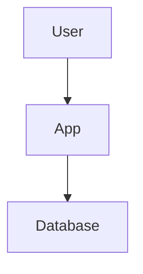

# YounderChat Azure Architecture Diagram Generator

Professional diagram generation tools that create Azure-style architecture diagrams using official Microsoft service icons. This tool replaces all Mermaid diagrams with high-quality visuals suitable for technical presentations and interviews.

## 🎯 Overview

The diagram generator creates professional Azure architecture diagrams using the `mingrammer/diagrams` library with official Azure service icons. All diagrams follow Microsoft Azure documentation standards and use actual infrastructure configurations from the Terraform codebase.

### ✨ Features

- **Professional Azure Styling**: Matches Microsoft Azure documentation standards
- **Official Service Icons**: Uses authentic Azure service representations
- **High-Quality Output**: 300 DPI PNG images suitable for presentations
- **Automated Generation**: One command generates all diagrams
- **Infrastructure-Accurate**: Uses real Azure service configurations from Terraform
- **Version Controlled**: Generated diagrams can be committed to Git

## 📋 Generated Diagrams

| Diagram | Description | Purpose |
|---------|-------------|---------|
| **system-overview** | High-level system architecture | System overview, stakeholder communication |
| **azure-infrastructure** | Complete Azure services topology | Infrastructure planning, cost analysis |
| **network-topology** | VNet, subnets, security groups | Network security, connectivity troubleshooting |
| **security-architecture** | Identity, RBAC, Key Vault | Security auditing, compliance validation |
| **cicd-pipeline** | GitHub Actions to Azure deployment | DevOps process, deployment troubleshooting |
| **data-model** | PostgreSQL schema and relationships | Database design, query optimization |
| **user-workflow** | End-to-end user journey | User experience, API design validation |

## 🚀 Quick Start

### Prerequisites

1. **Python 3.9+**: Check your Python version
   ```bash
   python --version
   ```

2. **Graphviz**: Required by the diagrams library
   ```bash
   # Windows (using Chocolatey)
   choco install graphviz
   
   # Windows (using Scoop)  
   scoop install graphviz
   
   # macOS (using Homebrew)
   brew install graphviz
   
   # Ubuntu/Debian
   sudo apt-get install graphviz
   ```

3. **Python Dependencies**: Install required packages
   ```bash
   pip install -r tools/requirements-diagrams.txt
   ```

### Generate All Diagrams

Generate all Azure architecture diagrams:

```bash
python tools/generate_all_diagrams.py
```

This creates PNG files in `docs/diagrams/generated/`:
- `system-overview.png`
- `azure-infrastructure.png`
- `network-topology.png`
- `security-architecture.png`
- `cicd-pipeline.png`
- `data-model.png`
- `user-workflow.png`

### Generate Specific Diagram

Generate a single diagram:

```bash
# Generate only the Azure infrastructure diagram
python tools/generate_all_diagrams.py --diagram azure-infrastructure

# Generate with verbose output
python tools/generate_all_diagrams.py --diagram network-topology --verbose

# Generate to custom directory
python tools/generate_all_diagrams.py --output-dir my-diagrams/
```

## 📊 Usage Examples

### Basic Generation
```bash
# Generate all diagrams with default settings
python tools/generate_all_diagrams.py

# Generate with verbose output to see file sizes and details
python tools/generate_all_diagrams.py --verbose
```

### Advanced Usage
```bash
# Generate specific diagram types
python tools/generate_all_diagrams.py --diagram system-overview
python tools/generate_all_diagrams.py --diagram security-architecture

# Custom output location
python tools/generate_all_diagrams.py --output-dir presentations/azure-diagrams/

# Generate for documentation review
python tools/generate_all_diagrams.py --verbose --output-dir review/diagrams/
```

## 🔧 Configuration

### Azure Service Icons

The tool uses the following Azure service icon mappings:

| Azure Service | Icon Class | Usage |
|---------------|------------|-------|
| Container Apps | `diagrams.azure.compute.ContainerApps` | Application runtime |
| PostgreSQL Flexible Server | `diagrams.azure.database.DatabaseForPostgresqlServers` | Database |
| Container Registry | `diagrams.azure.compute.ContainerRegistries` | Image storage |
| Key Vault | `diagrams.azure.security.KeyVaults` | Secret management |
| Virtual Network | `diagrams.azure.network.VirtualNetworks` | Networking |
| Managed Identity | `diagrams.azure.identity.ManagedIdentities` | Identity & access |
| Log Analytics | `diagrams.azure.analytics.LogAnalytics` | Monitoring |

### Customization

To modify diagram appearance, edit `tools/diagram_generator.py`:

```python
# Modify graph styling
self.graph_attr = {
    "fontsize": "16",      # Overall font size
    "fontname": "Arial",   # Font family
    "bgcolor": "white",    # Background color
    "rankdir": "TB",       # Direction (TB=top-bottom, LR=left-right)
    "splines": "ortho",    # Edge style (ortho=orthogonal, curved, etc)
    "nodesep": "1.0",      # Node separation
    "ranksep": "1.5"       # Rank separation
}
```

## 📁 File Structure

```
tools/
├── README.md                    # This file
├── requirements-diagrams.txt    # Python dependencies
├── diagram_generator.py         # Core diagram generation logic
└── generate_all_diagrams.py     # Batch generation script

docs/diagrams/generated/         # Generated diagram output
├── system-overview.png
├── azure-infrastructure.png
├── network-topology.png
├── security-architecture.png
├── cicd-pipeline.png
├── data-model.png
└── user-workflow.png
```

## 🛠️ Troubleshooting

### Common Issues

**1. Graphviz Not Found**
```bash
Error: Graphviz executables not found
```
Solution: Install Graphviz system package (see Prerequisites above)

**2. Module Import Errors**
```bash
ImportError: No module named 'diagrams'
```
Solution: Install Python dependencies
```bash
pip install -r tools/requirements-diagrams.txt
```

**3. Permission Errors**
```bash
PermissionError: [Errno 13] Permission denied
```
Solution: Ensure write permissions to output directory
```bash
chmod +w docs/diagrams/generated/
```

**4. Font Rendering Issues**
```bash
Warning: font "Arial" not found
```
Solution: Install system fonts or modify font settings in diagram_generator.py

### Verification

Test the installation:
```bash
# Verify Python environment
python -c "from diagrams.azure.compute import ContainerApps; print('✅ Azure icons available')"

# Test basic diagram generation
python -c "
from diagrams import Diagram
from diagrams.azure.compute import ContainerApps
with Diagram('Test', show=False, filename='test-diagram'):
    ContainerApps('Test App')
print('✅ Basic diagram generation works')
"
```

## 🎨 Integration with Documentation

### Replacing Mermaid Diagrams

After generating diagrams, update documentation files:

**Before (Mermaid):**
```markdown

```

**After (Generated Image):**
```markdown


*Figure: Complete Azure infrastructure showing Container Apps, PostgreSQL Flexible Server, and supporting services*
```

### Markdown Integration

Reference generated diagrams in documentation:
```markdown
## System Architecture


The system architecture shows the complete Azure infrastructure...

## Network Design


The network topology illustrates the VNet design with dedicated subnets...
```

## 📈 Performance and Quality

### Output Quality
- **Resolution**: 300 DPI for crisp printing and presentations
- **Format**: PNG for compatibility, SVG support planned
- **Styling**: Azure documentation standards
- **Icons**: Official Microsoft Azure service icons

### Generation Performance
- **Speed**: ~2-5 seconds per diagram
- **Memory**: Low memory footprint
- **Dependencies**: Minimal Python dependencies

## 🔄 Maintenance

### Updating Diagrams

Regenerate diagrams when infrastructure changes:
```bash
# After Terraform changes
python tools/generate_all_diagrams.py --verbose

# After documentation updates
python tools/generate_all_diagrams.py --diagram user-workflow
```

### Version Control

Generated diagrams should be committed to Git:
```bash
git add docs/diagrams/generated/*.png
git commit -m "Update Azure architecture diagrams"
```

## 📞 Support

### Documentation
- [mingrammer/diagrams Documentation](https://diagrams.mingrammer.com/)
- [Azure Architecture Icons](https://learn.microsoft.com/en-us/azure/architecture/icons/)
- [Graphviz Documentation](https://graphviz.org/documentation/)

### Issues
If you encounter issues:
1. Check the troubleshooting section above
2. Verify all prerequisites are installed
3. Test with verbose output: `--verbose`
4. Review the generated error messages

---

*Generated diagrams follow Microsoft Azure documentation standards and use official Azure service icons for professional technical documentation.*